Hey, I'm Shahruk. I've been building for the web for about ten years, mostly for small businesses in the US and UK: contractors, clinics, coaches, online stores. Somewhere past 1,500 sites I stopped counting.

These days I spend most of my time on three things:

**Headless WordPress.** Clients keep the WordPress editor they know. The front end is Next.js, pulling content through WPGraphQL, so pages load fast and I'm not fighting a theme.

**Shopify apps.** Custom apps and theme app extensions with Remix, Polaris and the Admin GraphQL API, for stores that need something the app store doesn't have.

**An AI sales assistant.** My own product. It sits on a business website, answers visitors from the company's own content, figures out who's a real lead and books the call.

I also care a lot about how a site feels. Scroll that doesn't stutter, text that comes in with some weight to it, small details nobody notices until they're missing. That's usually GSAP and Lenis on top of a clean build, something like this:

### What I work with

Next.js, React, TypeScript, Node.js, NestJS, PHP, WordPress (WPGraphQL, ACF, custom blocks and plugins), Shopify (Remix, Polaris, Liquid), WooCommerce, PostgreSQL, MySQL, GSAP, Lenis, Tailwind, OpenAI and Claude APIs.

### Get in touch

I take on a few projects at a time. Reach me on [Fiverr](https://www.fiverr.com/shahrukapp) or [Facebook](https://www.facebook.com/shahruk.maharuj).
